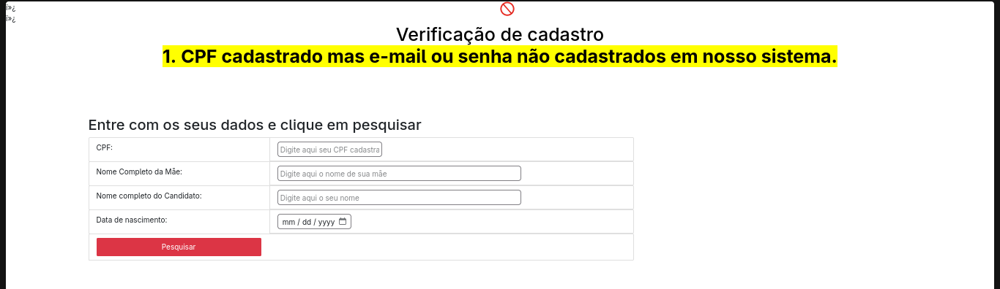
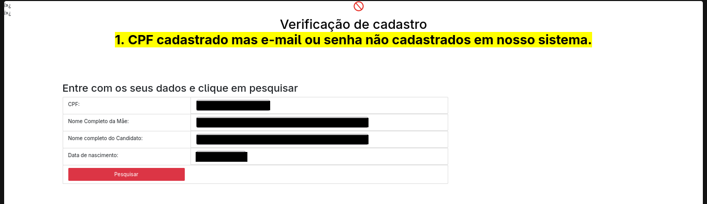
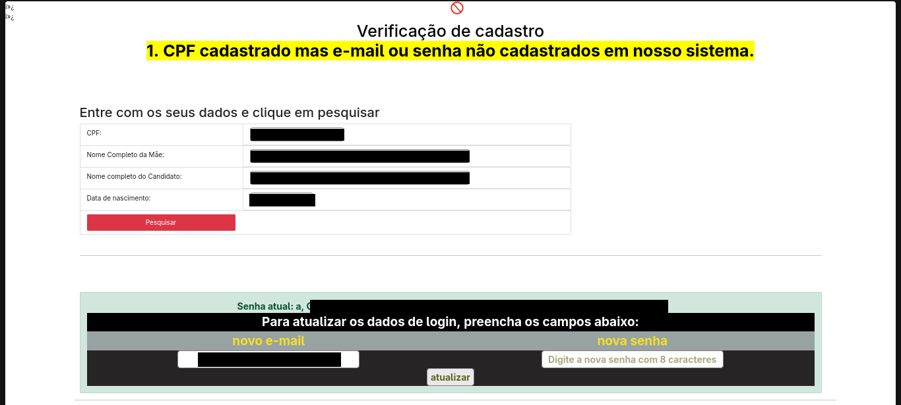

# Recuperação de conta com dados que não são segredos

**Tipo:** divulgação responsável  
**Alvo:** omitido de propósito. É um portal público de inscrições que ainda estava no ar quando escrevi isto.  
**Status:** reportei ao responsável e não tive retorno.  

## Aviso

Fiz tudo na minha própria conta, com os meus próprios dados. Não acessei a conta de ninguém. Os prints têm os meus dados cobertos de preto e o nome do sistema removido, porque o problema serve de aprendizado sem precisar expor o alvo nem ninguém.

## O que eu encontrei

O portal deixa a pessoa recuperar o acesso pela opção de "esqueci meu login". Olhando esse fluxo com calma, achei uma sequência de problemas que, juntos, deixam qualquer conta aberta.

### 1. O sistema confirma quais contas existem

Ao tentar entrar, a mensagem diferencia "esse cadastro não existe" de "o cadastro existe, mas a senha está errada". Isso já entrega para um estranho se uma pessoa tem conta ali ou não.

### 2. A recuperação pede só dados que não são segredos

A tela de recuperação pede quatro informações: CPF, nome completo da mãe, nome completo do candidato e data de nascimento.

O problema é que nenhum desses quatro é segredo. São dados de identificação, não de autenticação. Dá para obter esse tipo de informação a partir de fontes públicas e semipúblicas sobre uma pessoa. Então o que deveria ser uma prova de que "sou eu" não prova nada.

Preenchi com os meus próprios dados, aqui cobertos.

### 3. Ele mostra a senha atual em texto puro

Depois de enviar, o sistema mostrou na tela a senha atual da conta, escrita por extenso. Um site nunca deveria saber a sua senha original para conseguir mostrá-la assim. Isso quer dizer que as senhas não são guardadas de forma protegida.

Na mesma tela ele ainda deixa trocar o e-mail e a senha da conta.

### 4. Ele aceita uma senha de um caractere

A senha da conta que usei no teste era a letra `a`, sozinha. O sistema aceitou. Não existe regra mínima de tamanho ou complexidade.

## Por que isso é grave

Como os dados pedidos na recuperação não são segredos, a checagem não protege nada. Com eles, dá para descobrir a senha atual e ainda trocar o e-mail da conta. Trocar o e-mail é o ponto mais sério, porque tira da pessoa de verdade qualquer forma de recuperar o acesso depois.

E como isso não depende de nenhuma falha difícil, vale para qualquer conta do sistema, não só para uma. Junto com a senha, a conta expõe dados pessoais de quem se inscreveu.

## Como corrigir

- Não usar dados de identificação (CPF, nome, nome da mãe, data de nascimento) como prova de identidade na recuperação. O caminho certo é enviar um link ou código para o e-mail que já está cadastrado, ou usar verificação em duas etapas.
- Guardar as senhas com hash e nunca mostrar a senha para o usuário. No máximo, deixar criar uma nova.
- Não dizer se um CPF tem cadastro ou não. A resposta deve ser sempre a mesma.
- Ter uma regra de senha com tamanho mínimo.
- Antes de trocar o e-mail da conta, confirmar pelo e-mail antigo e avisar que a troca aconteceu.

## O que eu aprendi

A lição que levei é a diferença entre identificar e autenticar. Nome, CPF e data de nascimento dizem quem a pessoa é, mas não provam que é ela que está ali. Usar esse tipo de dado como senha é o erro no centro de tudo aqui.
