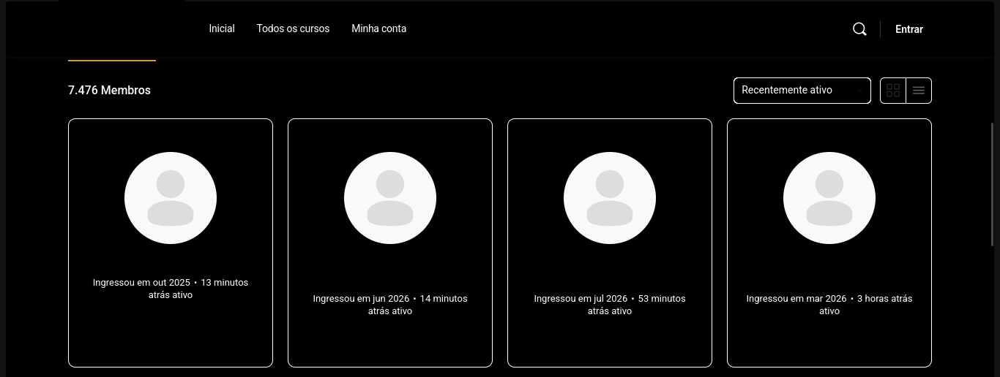
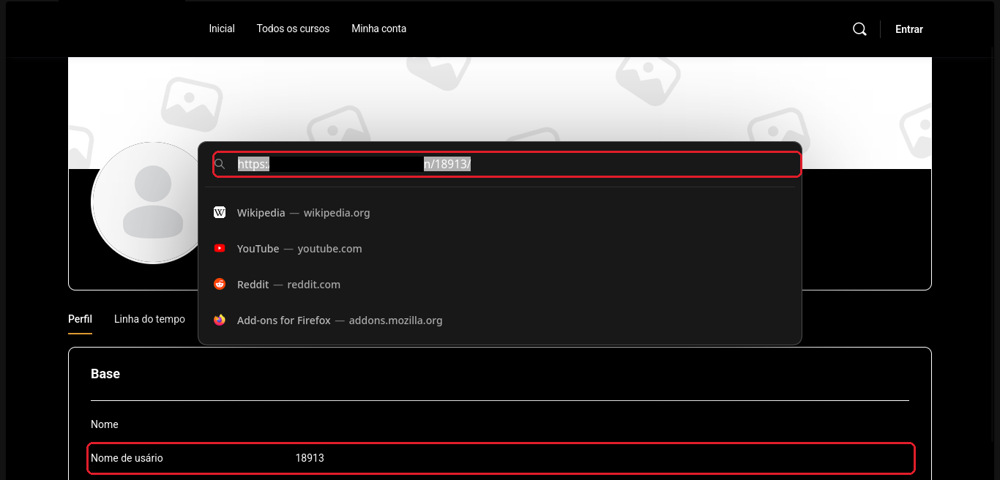
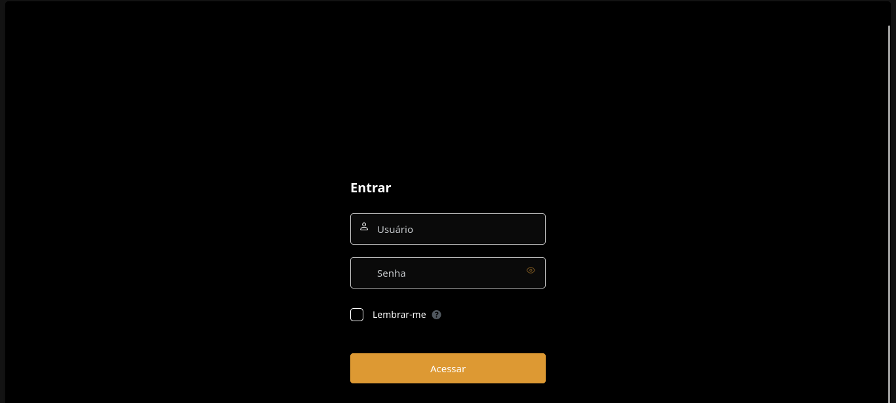

# A senha padrão era o CPF do aluno

**Tipo:** divulgação responsável
**Alvo:** omitido de propósito. É o ambiente de curso online (EAD) de uma escola, feito em WordPress.
**Status:** fui aluno desse curso, encontrei o problema e não tive retorno ao avisar.

## Aviso

Esse achado começou pela minha própria conta. Quando me inscrevi, recebi a minha senha por e-mail e ela era o meu CPF. Foi daí que desconfiei do resto. Entrei em um perfil público só para demonstrar o problema e não acessei a conta de ninguém. Nos prints, cobri de preto os nomes, o nome e o logo do site e o endereço. Deixei visível só o que explica a falha.

## O que eu encontrei

### 1. A plataforma lista todos os alunos em público

Sem fazer login, dá para abrir a lista de membros do curso. São milhares, cada um com o nome completo à mostra.

### 2. O nome de usuário é um número em sequência, e o endereço usa esse número

Cada aluno tem um perfil público. No perfil aparece o nome completo e o nome de usuário, e esse nome de usuário é só um número. O endereço da página termina nesse mesmo número.

Como o número é sequencial, trocar ele por um vizinho leva para o perfil de outro aluno. Isso quer dizer que dá para passar de perfil em perfil de forma automática, sem precisar adivinhar nada.

### 3. A senha padrão de cada conta é o CPF do dono

O login é o do próprio WordPress. No primeiro campo vai o nome de usuário (aquele número) e no segundo a senha.

A senha que vem de fábrica para cada aluno é o CPF dele. Quem nunca trocou a senha continua com o CPF como senha.

## Por que isso é grave

Juntando as três coisas: a lista de alunos é pública, o perfil liga o nome ao número de usuário, e a senha padrão é o CPF. O CPF de uma pessoa pode ser descoberto a partir do nome completo, que está ali à mostra. Então, para cada conta que nunca trocou a senha, todos os dados de entrada são alcançáveis.

O pior é a escala. Como nada disso depende de sorte ou de uma falha difícil, o mesmo caminho vale para a lista inteira de alunos, não só para um. Cada conta aberta expõe os dados pessoais daquele aluno.

## O ponto principal

Não é problema o CPF poder ser encontrado pelo nome. Isso é esperado, CPF e nome são dados de identificação, não de segredo. O erro de verdade é o sistema ter escolhido justamente um dado assim para ser a senha padrão. Senha precisa ser algo que só o dono saiba, e o CPF não é.

## Como corrigir

O mais importante, e o que resolve o grosso do problema:

- Não usar o CPF (nem nome, nem data de nascimento, nem nada que dê para descobrir) como senha padrão. Gerar uma senha aleatória para cada aluno. Isso é um script de duas linhas em Python. Entregar essa senha por um canal seguro e obrigar a troca no primeiro acesso.

Depois disso, uns cuidados que fecham as outras brechas:

- Não deixar a lista de todos os alunos aberta para quem não fez login. Se precisar existir, mostrar o mínimo e sem o nome completo.
- Não usar número em sequência como identificador no endereço. Trocar por um identificador que não dê para adivinhar. E, mesmo assim, conferir se quem pede a página tem direito de ver aquilo.
- Limitar tentativas de login e travar a conta por um tempo depois de muitos erros, para atrapalhar tentativas automáticas.
- Ter uma regra de senha forte para quando o aluno trocar.
- Oferecer verificação em duas etapas, principalmente porque esse é um sistema com dados pessoais de muita gente.

## O que eu aprendi

É a mesma lição do caso anterior, vista por outro ângulo. Dado que identifica uma pessoa não serve de senha. E uma escolha de conveniência, como "a senha é o CPF" ou "o usuário é um número em ordem", parece pequena, mas é ela que transforma um problema de uma conta em um problema de milhares.
